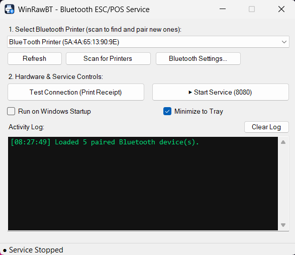

# WinRawBT

[English](README.md) | **Bahasa Indonesia**

Aplikasi tray Windows kecil yang memungkinkan POS berbasis browser mencetak struk ESC/POS ke **printer thermal Bluetooth yang sudah dipasangkan (paired)**, tanpa setting port COM dan tanpa dialog cetak Windows.

Ini versi Windows dari ide aplikasi Android **RawBT**: pilih printer yang sudah paired, klik *Start Service*, lalu kirim byte ESC/POS mentah ke `http://localhost:8080/` atau `ws://localhost:8080/`.



> **Status: beta (v0.1.x).** Tidak berafiliasi dengan atau didukung oleh proyek RawBT. Lihat [Printer yang sudah diuji](#printer-yang-sudah-diuji) dan [Masalah yang diketahui](#masalah-yang-diketahui).

## Fitur

- Menampilkan perangkat Bluetooth yang sudah paired, atau memindai dan memasangkan perangkat baru (Secure Simple Pairing, tanpa menebak PIN).
- Tombol Test Connection mencetak struk diagnostik.
- Endpoint HTTP `POST` dan WebSocket lokal, hanya di `localhost`.
- Menerima byte mentah, Base64, URL gaya RawBT `rawbt:base64,...` / `intent:base64,...`, URI `data:`, bungkus JSON, dan teks hex.
- Connect-on-demand: soket RFCOMM dibuka per pekerjaan cetak, jadi printer yang tidur tetap bisa dipakai. Pekerjaan cetak diantrekan satu per satu.
- System tray, opsi jalan otomatis saat Windows start, dan log aktivitas dengan pratinjau hex untuk setiap pekerjaan.
- Satu executable .NET Framework 4.8 yang kecil (sudah bawaan Windows 10/11), satu dependensi: [32feet.NET](https://github.com/inthehand/32feet).

## Persyaratan

- Windows 10 atau 11 dengan adapter Bluetooth yang berfungsi
- Printer thermal Bluetooth yang mendukung Serial Port Profile (SPP)
- Untuk build: .NET SDK 8 atau lebih baru (target `net48`)

## Instalasi

1. Unduh zip dari [Releases](../../releases) dan ekstrak di mana saja (simpan `WinRawBT.exe` dan `InTheHand.Net.Bluetooth.dll` di folder yang sama).
2. Jalankan `WinRawBT.exe`, pilih printer, klik **Test Connection**, lalu **Start Service**.

## Izinkan POS web Anda (penting)

Bridge hanya mendengarkan di `localhost`, tetapi website apa pun yang terbuka di browser pada PC yang sama bisa saja mengaksesnya. Karena itu secara default **request dari browser ditolak (HTTP 403)** sampai origin-nya diizinkan.

Edit `%AppData%\WinRawBT\config.json` lalu restart service:

```json
{
  "Port": 8080,
  "AllowedOrigins": ["https://pos.example.com"],
  "AllowAnyOrigin": false
}
```

- `AllowedOrigins`: origin persis (skema + host + port, tanpa path). Halaman yang dibuka dari path `file://` mengirim origin `null`.
- `AllowAnyOrigin`: `true` menerima semua website dan mengirim `Access-Control-Allow-Origin: *`. Pakai hanya di PC yang semua isi browsernya Anda percaya.
- Request tanpa header `Origin` (curl, aplikasi desktop) selalu diterima.
- Origin yang ditolak muncul di Activity Log beserta cara memperbaikinya.

## Pemakaian dari halaman web

```js
// Byte mentah
await fetch("http://localhost:8080/", {
  method: "POST",
  headers: { "Content-Type": "application/octet-stream" },
  body: new Uint8Array([0x1b, 0x40, ...new TextEncoder().encode("Halo\n"), 0x1d, 0x56, 0x42, 0x00]),
});

// Base64
await fetch("http://localhost:8080/", {
  method: "POST",
  headers: { "Content-Type": "text/plain" },
  body: btoa("\x1b@Halo\n\x1dV\x42\x00"),
});

// WebSocket
const ws = new WebSocket("ws://localhost:8080/");
ws.onopen = () => ws.send(btoa("\x1b@Halo\n"));
```

Respons: `200 {"status":"OK","bytesSent":N}`, `400` payload salah/kosong, `403` origin tidak diizinkan, `500` printer tidak terjangkau. `GET /` mengembalikan status service.

Dari shell: `curl -X POST --data-binary @receipt.bin -H "Content-Type: application/octet-stream" http://localhost:8080/`

`TestClient/test-pos.html` adalah halaman uji siap pakai (tambahkan `"null"` ke `AllowedOrigins` jika dibuka sebagai file lokal).

## Pengaturan lain

| Key | Default | Arti |
|---|---|---|
| `Port` | `8080` | Port listener |
| `AutoStartService` | `false` | Jalankan service saat aplikasi dibuka jika printer sudah tersimpan |
| `MinimizeToTray` | `true` | Menutup jendela akan menyembunyikannya ke tray |
| `PrependInit` | `false` | Tambahkan `ESC @` di depan pekerjaan yang belum diawali itu |

## Build

```
dotnet build -c Release
```

Hasilnya ada di `bin/Release/net48/`.

## Printer yang sudah diuji

| Printer | Hasil |
|---|---|
| Printer thermal EPPOS 58 mm | Berfungsi: struk tes dan pencetakan dari bridge |
| Model lain | Silakan buka issue dengan model printer, versi Windows, dan isi Activity Log |

## Masalah yang diketahui

- Beberapa printer gagal tersambung dengan `10049 AddressNotAvailable` (Windows tidak menemukan layanan SPP di perangkat). Penyebab umumnya printer dual-mode / BLE-only. Pasangkan ulang printer sebagai perangkat Bluetooth klasik dan pastikan Windows menampilkan layanan "Serial Port" untuk perangkat itu.
- Tidak ada konversi gambar atau HTML ke ESC/POS; bridge hanya meneruskan byte.
- Hanya satu printer dalam satu waktu.

## Catatan keamanan

- Hanya terikat ke `localhost` / `127.0.0.1`. Tidak ada autentikasi; perlindungan terhadap website adalah allowlist origin di atas.
- Jangan membuka port ini ke jaringan.

## Kontribusi

Issue dan pull request diterima. Untuk masalah printer, sertakan model printer dan isi Activity Log.

## Lisensi

[MIT](LICENSE). Memakai 32feet.NET (MIT).
