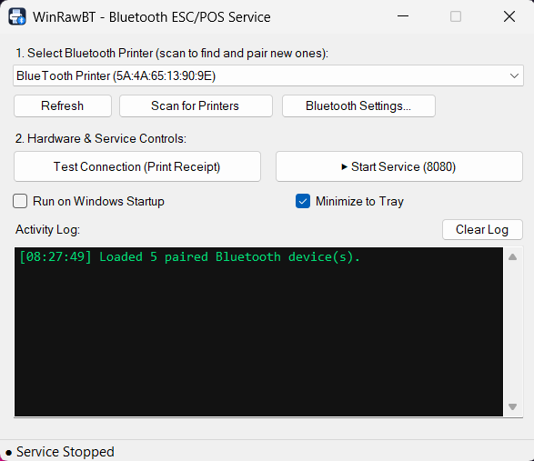

# WinRawBT

A small Windows tray app that lets a browser-based POS print ESC/POS receipts to a **paired Bluetooth thermal printer**, with no COM-port setup and no Windows print dialog.

It is a Windows take on the idea behind the Android app **RawBT**: pick a paired printer, click *Start Service*, and send raw ESC/POS bytes to `http://localhost:8080/` or `ws://localhost:8080/`.



> **Status: beta (v0.1.x).** Not affiliated with or endorsed by the RawBT project. See [Tested printers](#tested-printers) and [Known issues](#known-issues).

## Features

- Lists paired Bluetooth devices, or scans and pairs new ones (Secure Simple Pairing, no PIN guessing).
- Test Connection button prints a diagnostic receipt.
- Local HTTP `POST` and WebSocket endpoint on `localhost` only.
- Accepts raw bytes, Base64, RawBT-style `rawbt:base64,...` / `intent:base64,...` URLs, `data:` URIs, JSON wrappers, hex text.
- Connect-on-demand: opens the RFCOMM socket per job, so printers that sleep keep working. Jobs are serialized.
- System tray, optional start with Windows, activity log with hex preview of each job.
- Single small .NET Framework 4.8 executable (built into Windows 10/11), one dependency: [32feet.NET](https://github.com/inthehand/32feet).

## Requirements

- Windows 10 or 11 with a working Bluetooth adapter
- A Bluetooth thermal printer that exposes the Serial Port Profile (SPP)
- To build: .NET SDK 8 or newer (targets `net48`)

## Install

1. Download the zip from [Releases](../../releases) and extract it anywhere (keep `WinRawBT.exe` and `InTheHand.Net.Bluetooth.dll` together).
2. Run `WinRawBT.exe`, choose your printer, click **Test Connection**, then **Start Service**.

## Allow your web POS (important)

The bridge only listens on `localhost`, but any website open in a browser on the same PC could otherwise talk to it. So by default **browser requests are rejected (HTTP 403)** until their origin is allowed.

Edit `%AppData%\WinRawBT\config.json` and restart the service:

```json
{
  "Port": 8080,
  "AllowedOrigins": ["https://pos.example.com"],
  "AllowAnyOrigin": false
}
```

- `AllowedOrigins`: exact origins (scheme + host + port, no path). A page opened from a `file://` path sends the origin `null`.
- `AllowAnyOrigin`: `true` accepts every website and sends `Access-Control-Allow-Origin: *`. Only use it on a PC where you trust everything that runs in the browser.
- Requests without an `Origin` header (curl, desktop apps) are always accepted.
- A rejected origin is shown in the Activity Log with the exact fix.

## Usage from a web page

```js
// Raw bytes
await fetch("http://localhost:8080/", {
  method: "POST",
  headers: { "Content-Type": "application/octet-stream" },
  body: new Uint8Array([0x1b, 0x40, ...new TextEncoder().encode("Hello\n"), 0x1d, 0x56, 0x42, 0x00]),
});

// Base64
await fetch("http://localhost:8080/", {
  method: "POST",
  headers: { "Content-Type": "text/plain" },
  body: btoa("\x1b@Hello\n\x1dV\x42\x00"),
});

// WebSocket
const ws = new WebSocket("ws://localhost:8080/");
ws.onopen = () => ws.send(btoa("\x1b@Hello\n"));
```

Responses: `200 {"status":"OK","bytesSent":N}`, `400` bad/empty payload, `403` origin not allowed, `500` printer unreachable. `GET /` returns service status.

From a shell: `curl -X POST --data-binary @receipt.bin -H "Content-Type: application/octet-stream" http://localhost:8080/`

`TestClient/test-pos.html` is a ready-made test page (add `"null"` to `AllowedOrigins` if you open it as a local file).

## Other config keys

| Key | Default | Meaning |
|---|---|---|
| `Port` | `8080` | Listener port |
| `AutoStartService` | `false` | Start the service on launch when a printer is saved |
| `MinimizeToTray` | `true` | Closing the window hides to tray |
| `PrependInit` | `false` | Prepend `ESC @` to jobs that do not start with it |

## Build

```
dotnet build -c Release
```

Output is in `bin/Release/net48/`.

## Tested printers

| Printer | Result |
|---|---|
| _none confirmed yet_ | Please open an issue with model, Windows version, and the Activity Log |

## Known issues

- Some printers fail to connect with `10049 AddressNotAvailable` (Windows does not find an SPP service on the device). Dual-mode / BLE-only printers are the usual cause. Re-pair the printer as a classic Bluetooth device and check that Windows shows a "Serial Port" service for it.
- No image or HTML-to-ESC/POS conversion; the bridge forwards bytes only.
- One printer at a time.

## Security notes

- Binds to `localhost` / `127.0.0.1` only. No authentication; protection against websites is the origin allowlist above.
- Do not expose the port to a network.

## Contributing

Issues and pull requests are welcome. For a printer problem, include the printer model and the Activity Log output.

## License

[MIT](LICENSE). Uses 32feet.NET (MIT).
